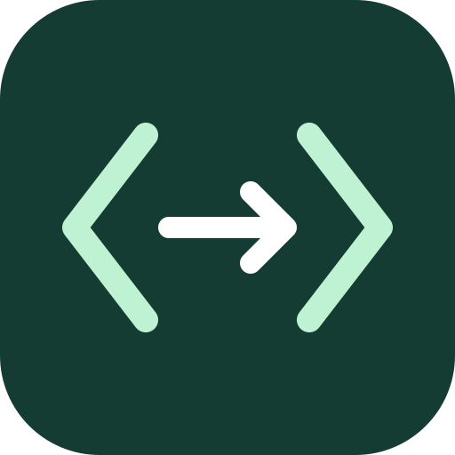

<p align="center"></p>

# CodeRelay

**Your code, into your practice editor.**

[](https://github.com/Rajveerx11/code-relay/actions/workflows/ci.yml)
[MIT license](LICENSE) · [Contributing](CONTRIBUTING.md) · [Security](SECURITY.md) · [Test evidence](TESTING.md)

CodeRelay is a small, open-source Chrome extension for students who write their own programs locally and need to import them into **practice pages that explicitly permit external code**. Load a saved UTF-8 file or read your clipboard, preview it, then confirm replacement of the whole editor. Your supplied indentation is preserved.

This is an independent project, not affiliated with or endorsed by CodeTantra. It does not generate answers, submit work, restore native Ctrl+V, or bypass exam/proctoring restrictions. Do not use it in assessments, exams or proctored sessions. Ask your instructor or platform administrator if permission is unclear.

## Install in Chrome

There is no Chrome Web Store listing. Installation is currently **unpacked source**, not a signed or independently verified release ZIP.

1. [Download the source ZIP](https://github.com/Rajveerx11/code-relay/archive/refs/heads/main.zip) and extract it completely into a permanent folder. Alternatively:
   ```sh
   git clone https://github.com/Rajveerx11/code-relay.git
   ```
2. Open `chrome://extensions` in a current version of Chrome and enable **Developer mode**, if your organization permits it.
3. Click **Load unpacked** and select the folder containing `manifest.json`, `README.md`, and `extension/`. A GitHub ZIP normally extracts as `code-relay-main`; a clone is normally `code-relay`. Do **not** select the ZIP or the `extension/` subfolder.
4. Pin **Practice Program Import — V1** from Chrome's Extensions menu. That is the current installed name (manifest version **1.0.1**); CodeRelay is the project name.

No Node, npm, Python, backend account or payment is needed to use the extension. The manifest requires Chrome 106 or newer; use current Chrome. Keep its folder in place. Managed Chrome may prohibit unpacked extensions; contact your administrator rather than changing security policy.

**Updating:** for a clone, run `git pull --ff-only` in its folder, reload the extension in `chrome://extensions`, then refresh your practice page. For ZIP installations, extract the updated source and load its root as above; remove the old unpacked installation if you change folder paths. Do not overwrite uncommitted local work.

## Import your program

1. Save your own program as UTF-8 in VS Code or another editor.
2. Open a trusted, permitted practice page. Click the intended editor before opening the extension so it can prefer that target. You do not need to select all its code.
3. Open the extension, check **External-code import is permitted here**, and click **Inspect practice editor**.
4. Check **Target contents** matches the editor you intend to change. If several editors are found, choose the correct target explicitly.
5. Choose your saved source file, click **Or read clipboard**, or paste into the extension preview. Review the full preview.
6. Leave **Replace entire editor (default)** selected, check **Replace all existing code with the preview above**, then click **Import code**. Confirmation starts unchecked.
7. Wait for verification and inspect the page yourself. The site's own save/run/submission workflow still applies; CodeRelay does not submit work or verify server persistence.

### Replacement, formatting and undo

- **Whole-editor replacement** ignores the cursor/selection and replaces the entire document in one operation, rather than clearing it and inserting later.
- **Snippet insertion** is optional: choose **Insert at cursor / replace selection**. Set the cursor/selection before opening the popup.
- Tabs, spaces, blank lines, trailing whitespace/newline and Unicode are retained. A leading BOM is removed and line endings are normalized for the editor. CodeRelay preserves supplied formatting; it does not auto-format code.
- **Undo last import** restores the previous full value and selection only while that popup stays open and the editor has not changed. Closing the popup discards its temporary backup. Do not rely on native Ctrl+Z.
- After import/undo, read-back checks occur immediately, then after about 150 ms and another 600 ms. Later site changes, visual rendering, autosave and submission are not guaranteed. There is no automatic retry or rollback.

## Compatibility

| Editor or context | Status |
| --- | --- |
| Visible native textareas | Supported |
| Ace with an exposed editor instance | Supported |
| CodeMirror 6 with a validated accessible view and one selection | Supported; local tests cover view 6.36.5 and 6.41.0 |
| Visible, accessible same-origin iframes, including nested frames | Supported; writes stay pinned to the selected document and exact URL |
| Monaco, CodeMirror 5, private/incompatible Ace or CM6 instances | Unsupported |
| Cross-origin, inaccessible/sandboxed, hidden, `about:blank` or `srcdoc` frames | Unsupported |
| Read-only/disabled editors and detected assessment/proctoring pages | Refused |

Source is limited to **200,000 JavaScript string code units** (shown as characters in the UI); saved files to **800,000 bytes**. Empty text and NUL characters are rejected.

CodeTantra practice workflows motivated this project, but editor configurations differ. A user has reported successful import; this does **not** establish compatibility with every tenant or independent verification of permissions, saving or submission. Try the local demo first, then only an authorized practice page. Assessment detection is heuristic, not proof that import is permitted.

CM6 integration uses model state/dispatch rather than rendered HTML. A narrowly guarded, version-sensitive DOM-to-view link must validate successfully or import is refused. See [architecture](ARCHITECTURE.md) and the [official EditorView API](https://codemirror.net/docs/ref/#view.EditorView).

## Try it safely on your own machine

Python 3 is needed only for the optional local demo/test server. From the project root:

```sh
python3 tools/serve.py --port 8766
# Windows alternative:
py -3 tools/serve.py --port 8766
```

Open `http://127.0.0.1:8766/demo/`. Focus its sample editor, open the extension, approve the local practice page, inspect it, and import `demo/sample.py`. Check the entire program and try Undo without closing the popup. Repeat at `http://127.0.0.1:8766/demo/frames.html` for an iframe-only editor. Stop the server with Ctrl+C; do not expose it publicly.

## Privacy and permissions

| Permission | Why it is used |
| --- | --- |
| `activeTab` | Temporary access following your extension action on the selected tab |
| `scripting` | Inspect and update the chosen supported editor |
| Optional `clipboardRead` | Requested only when you click the clipboard button; saved-file import does not need it |

There are no broad host permissions, background service worker, extension backend, telemetry, persistent source storage or explicit source uploads. Source and undo data live in popup memory. **Importing into a website gives that website your code**, and its own autosave/server behavior still applies. MAIN-world integration shares the page's JavaScript environment; only use trusted pages.

### Diagnostics and support

While the popup is still open, expand **Execution diagnostics**. It keeps the latest **100 entries** in memory, using fixed categories and timestamps. It excludes source text, clipboard contents, filenames, labels, URLs, account/student details and raw exceptions. Review **Report preview**, then explicitly **Export report** if needed. Closing the popup clears the log; an exported file remains until you delete it. Clearing the log does not clear source or undo data.

[Report a bug](https://github.com/Rajveerx11/code-relay/issues/new/choose) with a harmless local reproduction and a reviewed diagnostic report. **Never post credentials, cookies, tokens, student IDs, private page URLs, assignment answers or source-preview screenshots.** Security concerns belong in [private reporting](SECURITY.md), not public issues.

## Troubleshooting

- **Missing manifest / extension load error:** extract the ZIP and select its root containing `manifest.json`. Keep that folder in place.
- **No supported writable editor:** check the compatibility table, focus one visible editor and inspect again. Cross-origin/private instances cannot be made supported by granting broad access; ask the site for an approved import method.
- **Only part of the program changed:** reload the extension and select the default whole-editor replacement mode, then confirm it. Selection mode intentionally edits only a range.
- **Editor changed:** content, selection or identity no longer matches the approved snapshot. Inspect again instead of overwriting stale state.
- **Verification failed or a write may be partial:** inspect the actual page before doing anything else. Do not assume it was rolled back. Export diagnostics and use harmless code for a local reproduction.
- **Invalid UTF-8:** resave the file with UTF-8 encoding.
- **Clipboard denied:** use a saved file or paste into the preview. This does not fix or bypass the site's clipboard restrictions.
- **Managed browser blocks installation:** ask your administrator; do not weaken its controls.

## Contribute

Bug reproductions, accessibility improvements, documentation fixes and focused editor-compatibility tests are welcome. Start with [CONTRIBUTING.md](CONTRIBUTING.md), [architecture](ARCHITECTURE.md) and [test instructions](TESTING.md). Use synthetic code and keep existing consent, identity, permission and assessment safeguards intact.

Latest recorded runtime validation: **68 Node tests and 47 sandboxed browser-fixture checks passed**. CI runs Node 22/24 on Windows/Linux. These fixtures are not native installed-extension or live CodeTantra verification. Historical `CHECKSUMS.sha256` and `VERIFICATION.json` describe an old baseline, not the current download; see [TESTING.md](TESTING.md).

## License and artwork

CodeRelay's code and original artwork are available under the [MIT License](LICENSE). Third-party libraries and trademarks remain under their owners' terms. The optional browser fixtures fetch Ace and CodeMirror from CDNs; those libraries are not bundled with the extension.

Original logo: [SVG](assets/code-relay-logo.svg) · [512px PNG](assets/code-relay-logo.png). The brackets and relay arrow are project artwork, not a CodeTantra affiliation mark.
